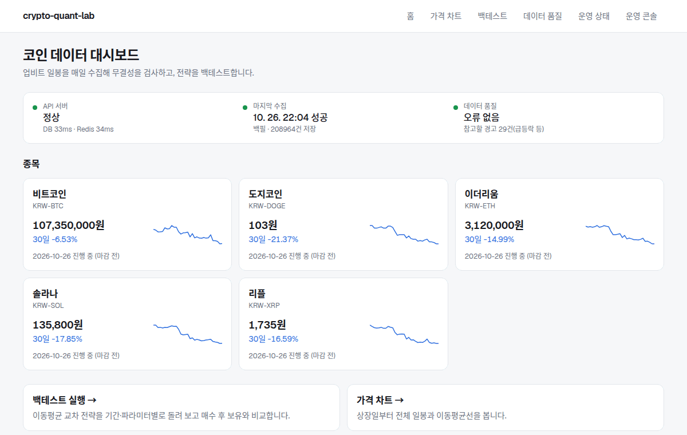
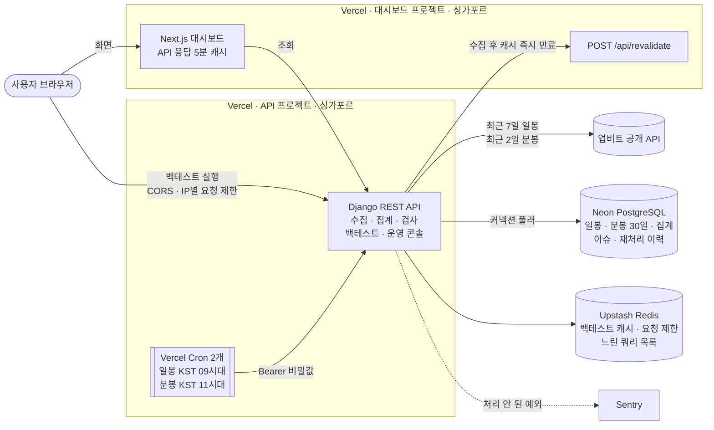

# crypto-quant-lab

업비트 코인 일봉·1분봉을 매일 수집하고, 데이터 무결성과 두 원본 사이 정합성을 검사한 뒤, pandas로 전략을 백테스트해 REST API와 대시보드로 제공하는 프로젝트입니다. 운영 콘솔에서 종목·날짜별 수집·집계·검사 상태와 재처리 이력을 봅니다.

```
업비트 공개 API → 일봉·분봉 수집(매일 Cron) → 집계·무결성·정합성 검사 → pandas 백테스트 → DRF API (+ Redis 캐시) → Next.js 대시보드·운영 콘솔
```

- **대시보드:** https://crypto-quant-dashboard-oofysotry.vercel.app (홈·가격 차트·백테스트·데이터 품질·운영 상태·운영 콘솔)
- **운영 API:** https://crypto-quant-lab-oofysotry.vercel.app/api/health/ (API 주소 `/`로 들어오면 대시보드로 이동)
- **API 문서(Swagger):** https://crypto-quant-lab-oofysotry.vercel.app/api/docs/
- 대상 종목: KRW-BTC, KRW-ETH, KRW-XRP, KRW-SOL, KRW-DOGE (상장일부터 약 13,700개 일봉)



## 기술 스택

| 구분 | 사용 기술 |
|---|---|
| 백엔드 | Python 3.12, Django 5.2, Django REST Framework, drf-spectacular |
| 데이터·계산 | pandas, numpy, Decimal |
| DB·캐시 | PostgreSQL 18 (운영: Neon), Redis (운영: Upstash) — v1은 MySQL 8(Aiven), 태그 `v1-mysql` |
| 프론트엔드 | Next.js 16 (App Router), React 19, TypeScript, Tailwind CSS 4, lightweight-charts |
| 배포·운영 | Vercel (서버리스 함수 + Cron, 대시보드는 별도 프로젝트), Sentry |
| 품질 | pytest (테스트 283개), ruff, ESLint, GitHub Actions (lint + API 스키마 검증 + PostgreSQL·Redis 컨테이너로 pytest) |

## 아키텍처



| 구분 | 로컬 | 운영 |
|---|---|---|
| 대시보드 | `next dev` | Vercel 별도 프로젝트 (Root Directory `frontend`, 싱가포르 `sin1`) |
| API | `manage.py runserver` | Vercel 서버리스 함수 (싱가포르 `sin1`) |
| DB | PostgreSQL 18 컨테이너 | Neon PostgreSQL 18 (싱가포르, PgBouncer 풀러, SSL) |
| 캐시·요청 제한 | Redis 컨테이너 | Upstash Redis (싱가포르) |
| 정기 수집 | `manage.py collect`, `collect_minutes` + `aggregate_minutes` | Vercel Cron 2개 → 일봉 `GET /api/cron/collect/` (매일 KST 09시대), 분봉 `GET /api/cron/minutes/` (KST 11시대). 무료 플랜이라 지정한 시각부터 59분 사이 아무 때나 실행 |
| 오류 모니터링 | 콘솔 로그 | Sentry |

대시보드·API 함수와 DB·캐시를 모두 싱가포르에 둡니다. 처음에는 API 함수가 미국에서 돌아 응답이 4.2초 걸렸는데, 같은 리전으로 모아 0.46초로 줄였습니다. 나중에 만든 대시보드 프로젝트도 기본 리전이 미국이어서 같은 방식으로 옮겼습니다.

```
backend/
├── config/      설정(base/local/prod), health API, URL
├── market/      업비트 클라이언트, 수집·upsert, 무결성 검사, 조회 API, Cron API
├── backtest/    전략, 시뮬레이션 엔진, 성과 지표, 결과 저장·캐시, 백테스트 API
└── tests/       pytest
frontend/
├── app/         화면(홈 /, 가격 차트 /assets/[symbol], 백테스트 /backtest, 데이터 품질 /integrity, 운영 상태 /status)
├── components/  상태 요약 띠, 종목 카드, 백테스트 폼·지표 비교, charts/(캔들·비율 차트)
└── lib/         API 호출·타입, 표시 형식, 이동평균·드로다운 계산
```

## 주요 기능

### 1. 데이터 수집 (`market/upbit.py`, `market/services.py`)
- 업비트 일봉 API를 200개씩 과거로 넘기며 받습니다. 요청 간격은 0.15초이고, 429·5xx·네트워크 오류는 지수 백오프로 최대 5번 재시도합니다.
- 가격은 `Decimal`로 파싱·저장해 정밀도를 잃지 않습니다.
- `unique(asset, date)` + upsert라서 같은 수집을 여러 번 돌려도 중복이 생기지 않습니다(멱등).
- 매일 **최근 7일을 다시 받아** 덮어씁니다. 진행 중인 봉이 마감된 값으로 바뀌고, 하루 수집이 실패해도 다음 날 자동으로 메워집니다.
- 아직 마감되지 않은 오늘 봉은 `is_final=False`로 저장하고 백테스트에서 뺍니다. 업비트 일봉은 KST 09:00에 바뀌는 점을 반영했습니다.

### 2. 무결성 검사 (`market/integrity.py`)

| 규칙 | 조건 | 심각도 |
|---|---|---|
| 결측일 | 상장일 ~ 어제 사이에 빠진 날짜 | error |
| OHLC 오류 | `low ≤ open, close ≤ high` 위반 | error |
| 0 이하 가격 | 가격 ≤ 0 | error |
| 거래량 0 | 거래량 = 0 | warning |
| 급등락 | 전일 대비 ±30% 초과 | warning |
| 수집 지연 | 최신 확정 봉이 2일 이상 지남 | error |
| 분봉·일봉 불일치 (v2) | 분봉으로 만든 일봉과 업비트 일봉의 시가·고가·저가·종가가 다름 / 거래량·거래대금만 상대 1e-6 넘게 다름 | error / warning |
| 분봉 긴 빈 구간 (v2) | 분봉이 30분 이상 연속으로 없음. 다른 종목도 같은 시간에 비었으면 "전 종목 동시"로 표시 | warning |

- 해결되지 않은 error가 백테스트 기간에 있으면 **결과를 내지 않고 422로 거부**합니다. 빈 날을 앞 값으로 채우면(forward-fill) 틀린 결과가 조용히 나오기 때문입니다.
- 실제 사례: ETH·XRP의 2017-10-21~23 결측은 업비트 원본에도 없는 데이터임을 확인하고, 관리자 화면에서 사유를 남겨 해결 처리했습니다.

### 3. 백테스트 (`backtest/`)
- 전략: 이동평균 교차(`ma_cross`), 매수 후 보유(`buy_and_hold`). 전략은 "목표 비중(0/1)"만 만들고, 엔진이 **하루 늦춰**(`shift(1)`) 적용해 미래참조를 막습니다. 미래 가격을 바꿔도 과거 포지션이 바뀌지 않는지 회귀 테스트로 확인합니다.
- 수수료는 포지션이 바뀐 날에만 차감합니다(기본 0.05%).
- 지표: 총수익률, CAGR, MDD, 샤프(코인은 24시간 거래라 365일 기준), 거래 횟수, 승률, 노출 비율. 같은 기간의 Buy&Hold 결과를 항상 함께 돌려줍니다.
- 결과는 DB에 저장하고 Redis에 캐시합니다. 캐시 키는 `bt:{파라미터 SHA-256}:{데이터 버전}`이라서, 새 데이터가 들어오면 키가 바뀌어 캐시를 따로 지울 필요가 없습니다.

**예시 결과** (KRW-BTC, 2021-01-01 ~ 2026-09-30, 수수료 0.05%)

| 전략 | 총수익 | CAGR | MDD | 샤프 | 거래 |
|---|---|---|---|---|---|
| MA 교차 (20/60) | +539.5% | 38.1% | -39.9% | 1.08 | 19 |
| Buy&Hold | +254.8% | 24.6% | -74.1% | 0.69 | 1 |

한 종목·한 기간·한 파라미터 결과라서 "MA 교차가 더 좋은 전략"이라고 말할 수는 없습니다. 확인할 수 있는 건 하락장에서 현금으로 빠져 MDD가 줄었다는 점입니다.

### 4. 분봉 수집·집계·정합성 대조·재처리 (v2, `market/minutes.py`, `market/aggregates.py`, `market/reprocess.py`)

v2([로드맵](docs/ROADMAP.md))에서 데이터 규모를 키우는 중입니다. 아래 수치는 **로컬 PostgreSQL 18, 5종목 × 1년(2025-10-23 ~ 2026-10-22) 1분봉 2,579,886행**에서 측정했습니다. 운영 반영은 1단계 D6에서 합니다(운영 DB 용량 때문에 최근 30일만).

- **수집:** 1분봉을 200개씩 과거로 넘기며 받고, 2,000행마다 `INSERT … ON CONFLICT` upsert로 바로 저장합니다. 백필이 중간에 끊겨도 저장한 만큼 남고 `--to`로 이어 받습니다. 1년치를 처음부터 다시 받아 종목별 행 수·값 해시가 같고 새 행이 0건임을 확인했습니다(멱등). 병목은 DB 쓰기(초당 약 1.2만 행)가 아니라 업비트 요청 제한(초당 약 1,100행)입니다.
- **집계:** 분봉 → 시간봉·일봉(OHLCV, 거래대금, VWAP, 1분 수익률 변동성, 원본 분봉 수, 집계 버전)을 **SQL 한 문장**으로 만듭니다(`date_trunc` + 윈도 함수 `first_value`·`last_value`·`lag` + `INSERT … ON CONFLICT DO UPDATE … WHERE 값이 다를 때만`). 5종목 1년치 29초. 값이 같으면 갱신하지 않아서, 다시 돌리면 "바뀐 행 0"이 나옵니다.
- **참조 구현 대조:** 같은 정의를 pandas + `Decimal`로 따로 계산해 DB 결과와 전부 비교합니다. 처음 비교에서 시간봉 8,741개 중 1개의 VWAP가 마지막 자리만 달랐고, PostgreSQL `numeric` 나눗셈의 이중 반올림이 원인이었습니다(아래 트러블슈팅). 고친 뒤 **5종목 × 시간봉·일봉 43,699 + 1,825행, 차이 0건**.
- **업비트 일봉과 대조:** 분봉으로 만든 일봉 1,825일이 업비트 일봉과 **시가·고가·저가·종가·거래량까지 모두 일치**했습니다.
- **빈 구간 규칙을 데이터로 정했습니다:** 거래가 없는 분은 업비트가 분봉을 주지 않아서 "빈 분 비율"로는 수집 누락과 한산한 시장을 구분할 수 없었습니다(DOGE는 평소에도 약 5%, 많게는 31%가 빔). 대신 하루 최장 빈 구간을 보니 30분 이상은 **5종목이 동시에 KST 02시부터 5~7시간 빈 5일(거래소 점검으로 추정)**뿐이었고, 그 외엔 길어야 15분이었습니다. 그래서 규칙을 "30분 이상 빈 구간 + 전 종목 동시 여부"로 정했고, 1년치 결과는 warning 25건(5일 × 5종목) 모두 "전 종목 동시"입니다. 분봉 1시간을 일부러 지우면 빈 구간과 거래량 불일치가 함께 잡히는 것도 확인했습니다.

- **재처리:** 종목·기간·대상(분봉 재수집 / 재집계 / 일봉 재수집)을 정하면 원본과 DB를 행 단위로 비교해 **다른 것만** 추가·변경·삭제하고, 집계와 정합성 검사를 다시 돌린 뒤 이력(`ReprocessRun`)을 남깁니다.
  - 전부 트랜잭션 하나라 중간에 실패하면 모두 롤백됩니다. 기본은 dry-run이고, dry-run은 실제 실행과 같은 코드를 돌린 뒤 롤백해서 미리 본 차이와 실제 차이가 어긋나지 않습니다.
  - 같은 종목의 날짜가 하루라도 겹치는 재처리는 `pg_try_advisory_xact_lock`(종목·날짜마다)으로 막아 바로 409를 돌려줍니다. 실제 HTTP 요청 두 개로 확인했습니다(겹친 쪽 0.08초 만에 409).
  - 일봉은 값이 같으면 갱신하지 않아서, 실제로 바뀐 날이 있을 때만 백테스트 캐시 키(데이터 버전)가 바뀝니다.
  - **실데이터 확인:** BTC 분봉 1시간(60개)을 지움 → 재집계로 빈 구간·거래량 불일치 경고 2건 탐지 → 분봉 재처리 dry-run(추가 60, "이슈 2건 해결 예정", DB 그대로) → 실행 3.2초 → 다시 실행하면 바뀐 행 0. 복구 후 5종목 분봉 전체 해시가 삭제 전 기준값과 **완전히 같았고**, 이슈 2건은 자동 해결, 이력 4건이 남았습니다.

```bash
python manage.py collect_minutes --days 365          # 1년치 분봉 (5종목 약 45분)
python manage.py aggregate_minutes --all             # 시간봉·일봉 집계 + 분봉 정합성 검사
python manage.py reprocess --asset KRW-BTC --target minutes \
  --start 2026-09-10 --end 2026-09-10 --reason "분봉 누락 복구"           # dry-run, --apply를 주면 반영
```

### 5. 쿼리·인덱스 튜닝 (v2, 자세한 기록: [docs/performance.md](docs/performance.md))

같은 로컬 1년치 데이터에서, 시나리오 9개를 실제 API·검사 코드로 실행하고 SQL마다 `EXPLAIN (ANALYZE, BUFFERS)`를 워밍업 1회 + 5회 이상 중앙값으로 쟀습니다(`manage.py explain_scenarios`). 모든 응답에는 요청당 쿼리 수·DB 시간이 `Server-Timing` 헤더로 붙습니다(`connection.execute_wrapper`).

| 시나리오 | 전 → 후 (요청 시간) | 바꾼 것 |
|---|---|---|
| 종목별 최신 상태 | 613ms → 7ms (쿼리 4 → 1) | `GROUP BY` + `Max`(260만 행 Seq Scan) → 종목별 `ORDER BY ts DESC LIMIT 1` 서브쿼리(인덱스 끝 한 칸) |
| 분봉 목록 깊은 페이지 | 213ms → 45ms (DB 164 → 0.3ms) | 페이지 번호(매번 52만 행 `COUNT` + `OFFSET`) → keyset 페이지네이션 |

- **새 인덱스는 넣지 않았습니다.** 기존 unique(asset_id, ts)에 대해 커버링(`INCLUDE`), 순서 반대(ts, asset_id), BRIN, 부분 인덱스를 트랜잭션 안에서 만들어 재고 롤백했습니다. 커버링은 크기 2.7배에 2ms 이득, (ts, asset_id)는 앱 쿼리가 오히려 느려짐(종목 조건 없는 쿼리도 PostgreSQL 18 skip scan이 기존 인덱스를 씀), BRIN은 upsert·재처리로 물리 순서가 섞여(`correlation` −0.08) 5배 느렸습니다.
- 인덱스 부풀림도 찾았습니다. 같은 행으로 새로 만든 인덱스가 절반 크기(151MB → 78MB)여서, 대량 재적재 뒤 `REINDEX CONCURRENTLY`를 운영 절차로 남겼습니다.
- 조회 API 9개의 요청당 쿼리 수를 테스트로 고정해 N+1이 생기면 실패하게 했습니다.

### 6. 운영 콘솔·관측성 (v2)

- **분봉 파이프라인 Cron:** 일봉 Cron과 따로 매일 KST 11시대에 `/api/cron/minutes/`를 부릅니다. 끝난 최근 2일(UTC)의 분봉을 다시 받아 → 시간봉·일봉 집계 → 분봉 검사(일봉 대조·빈 구간) → 보관 기간(운영 30일)이 지난 분봉 삭제까지 하고, 단계별 소요 시간을 실행 기록에 남깁니다. 운영에서 한 번 실행에 **11.7초**(5종목 × 2일 13,931행, 300초 제한의 4%)가 걸렸습니다. 2일을 다시 보기 때문에 하루 실패하거나, 일봉 Cron보다 먼저 돌아 대조를 건너뛴 날도 다음 날 메워집니다. 종목마다 재처리와 같은 (종목, 날짜) advisory lock을 잡아서, 같은 날을 재처리하는 중이면 그 종목은 건너뜁니다(다음 날 다시 처리).
- **운영 데이터:** 분봉 최근 30일을 운영 DB(Neon 무료 0.5GB)에 같은 파이프라인으로 적재했습니다(208,964행, 4분). 로컬 1년치와 겹치는 27일을 종목별 행 수·값 해시로 비교해 **5종목 모두 일치**했습니다. 보관 기간 밖 날짜의 분봉·집계 재처리는 거부합니다(분봉이 지워진 날을 재집계하면 남은 집계 봉까지 지워지므로).
- **운영 콘솔(`/ops`):** 종목 × 최근 30일 표에서 칸마다 오류 / 분봉 없음 / 집계 안 됨(집계에 쓴 분봉 수 ≠ 지금 분봉 수) / 경고 / 정상을 색으로 보여 주고, 칸을 누르면 그날의 10분 이상 빈 구간, 시간대별 집계, 분봉 집계 vs 업비트 일봉, 이슈, 재처리 이력(미리 보기 포함, 바뀐 테이블별 행 수·요청자·사유)이 나옵니다. 표는 칸 수와 상관없이 쿼리 6개(테이블마다 GROUP BY 한 번)이고, 운영 DB에서 86ms입니다. 화면은 조회만 하고 재처리는 관리자 토큰이 있는 API·커맨드로만 실행합니다.
- **관측성:** 모든 응답에 `Server-Timing`(요청당 쿼리 수·DB 시간)을 붙이고, `SLOW_QUERY_MS`(기본 200ms) 이상 걸린 쿼리는 경고 로그와 함께 Redis에 최근 50건을 남깁니다(SQL 모양만, 파라미터 값은 저장하지 않음). `/api/health/`에 최근 24시간 건수를, 운영 상태 화면에 목록과 분봉 파이프라인 단계별 시간을 보여 줍니다.

## API

| 메서드 | 경로 | 설명 |
|---|---|---|
| GET | `/` | 대시보드로 302 이동 (`DASHBOARD_URL`이 없으면 404) |
| GET | `/api/health/` | DB·Redis 연결 상태와 소요 시간, 느린 쿼리 기준·최근 24시간 건수 |
| GET | `/api/assets/` | 종목 목록 |
| GET | `/api/candles/?symbol=KRW-BTC&from=2025-01-01&to=2025-12-31` | 일봉 (페이지당 500개, 최대 5000) |
| GET | `/api/minutes/?symbol=KRW-BTC&from=2026-10-01T00:00Z&to=2026-10-02T00:00Z` | 분봉 (v2, UTC, `to` 미포함, keyset 페이지네이션 — `next` 링크로 이어 읽기, 페이지당 500개·최대 5000) |
| GET | `/api/bars/?symbol=KRW-BTC&unit=hour` | 분봉으로 만든 집계 봉 (v2, `unit=hour` 시간봉·`day` 일봉, VWAP·변동성·원본 분봉 수 포함, keyset) |
| GET | `/api/minutes/status/` | 종목별 마지막 분봉·시간봉·일 집계 시각 (v2) |
| GET | `/api/integrity/summary/` | 종목별 데이터 범위·열린 이슈 수·마지막 수집 |
| GET | `/api/integrity/issues/?symbol=&type=&severity=&resolved=` | 무결성 이슈 목록 |
| GET | `/api/collection-runs/?kind=daily\|minutes` | 수집 실행 기록 (일봉 수집 / 분봉 파이프라인, 분봉은 단계별 소요 시간 포함) |
| GET | `/api/ops/days/?days=30` | 운영 콘솔: 활성 종목 × 최근 N일 상태 표 (오류 / 분봉 없음 / 집계 안 됨 / 경고 / 정상) |
| GET | `/api/ops/days/{symbol}/{date}/` | 운영 콘솔: 하루 상세 (빈 구간, 시간대별 집계, 업비트 일봉 대조, 이슈, 재처리 이력) |
| GET | `/api/ops/slow-queries/` | 최근 느린 쿼리 50건 (`SLOW_QUERY_MS` 이상, SQL 모양만) |
| POST | `/api/backtests/` | 백테스트 실행 (새로 계산 201, 기존 결과 200, 입력 오류 400, 데이터 문제 422, 분당 20회 초과 429) |
| GET | `/api/backtests/{id}/` | 백테스트 결과 조회 |
| POST | `/api/reprocess/` | 재처리 (v2). `Authorization: Bearer <ADMIN_API_TOKEN>` 필요, 기본 dry-run(`"dry_run": false`일 때만 반영), 성공 201·같은 종목·기간 실행 중 409·실패 500(전부 롤백), 분봉·집계 31일·일봉 366일까지 |
| GET | `/api/reprocess/?symbol=&date=` | 재처리 이력 목록 (그 날짜를 포함한 재처리만 거를 수 있음) |
| GET | `/api/reprocess/{id}/` | 재처리 이력 (누가·왜·무엇이 바뀌었는지, 날짜별 차이, 재검증 결과) |
| GET | `/api/cron/collect/` | 정기 일봉 수집 (Vercel Cron 전용, `Authorization: Bearer <CRON_SECRET>` 필요, 전 종목 실패 시 500, API 문서에는 숨김) |
| GET | `/api/cron/minutes/` | 정기 분봉 파이프라인 (같은 인증, 최근 2일 수집 → 집계 → 검사 → 보관 기간 지난 분봉 삭제) |
| GET | `/api/docs/`, `/api/schema/` | Swagger UI, OpenAPI 스키마 |

일반 API는 IP당 분당 120회로 제한합니다. 제한 카운터는 Redis에 있어서 서버리스 인스턴스가 여러 개여도 함께 셉니다.

```bash
curl -X POST https://crypto-quant-lab-oofysotry.vercel.app/api/backtests/ \
  -H 'Content-Type: application/json' \
  -d '{"symbol":"KRW-BTC","strategy":"ma_cross","short":20,"long":60,"start":"2021-01-01","end":"2026-09-30"}'
```

## 로컬 실행

필요한 것: Python 3.12, Docker

```bash
# 1. PostgreSQL·Redis 실행
docker compose up -d

# 2. 가상환경과 패키지
cd backend
python -m venv .venv && source .venv/bin/activate
pip install -r requirements-dev.txt

# 3. 환경변수 (기본값 그대로 docker compose와 맞음)
cp .env.example .env

# 4. 테이블 생성(종목 5개는 마이그레이션이 넣음) → 상장일부터 전체 수집(몇 분 걸림)
python manage.py migrate
python manage.py collect --all

# 5. 서버 실행 → http://127.0.0.1:8000/api/docs/
python manage.py runserver
```

이후 최근 7일만 다시 받을 때는 `python manage.py collect`를 실행합니다.

### 대시보드

필요한 것: Node.js 20.9 이상, 위의 API 서버(8000번)가 실행 중일 것

```bash
cd frontend
npm install
NEXT_PUBLIC_API_BASE=http://127.0.0.1:8000 npx next dev -p 3000   # → http://localhost:3000
```

API 서버의 CORS 기본값이 `http://localhost:3000`이라 따로 설정할 필요가 없습니다.

### 테스트

```bash
cd backend
pytest          # 283개, PostgreSQL·Redis 컨테이너가 떠 있어야 함
ruff check . && ruff format --check .
```

외부 API(업비트)는 테스트에서 실제로 호출하지 않습니다. HTTP는 `responses`로 가짜 응답을 넣고, 재시도 대기 시간도 주입받아서 실제로 기다리지 않습니다.

## 설계 결정

| 결정 | 이유 |
|---|---|
| 가격은 `Decimal`, 수익률 계산은 `float` | 저장값은 원본과 정확히 같아야 하고, 수익률은 pandas 벡터 연산이 필요합니다. 계산 직전에 한 번만 바꿉니다 |
| 신호를 하루 늦춰 적용 (`shift(1)`) | t일 종가를 보고 내린 판단으로 t일 수익을 얻을 수는 없습니다. 미래참조 방지 회귀 테스트로 보호합니다 |
| 결측은 메우지 않고 422 | 틀린 결과를 조용히 내는 것보다 이유를 알려 주고 거부하는 편이 안전합니다 |
| upsert + 최근 7일 재수집 | 재실행·재시도에 안전하고(멱등), 미완성 봉과 하루치 실패가 자동으로 보정됩니다 |
| 캐시 키에 데이터 버전 포함 | 캐시 무효화 코드가 필요 없고, 오래된 결과를 돌려줄 수 없습니다 |
| 서버리스(Vercel) + Cron | 상시 서버 없이 무료로 운영합니다. 대신 Celery worker·beat 같은 상시 프로세스를 띄울 수 없어서 정기 수집은 Cron으로 하고, `CONN_MAX_AGE=0`으로 요청마다 DB 연결을 닫습니다 |
| 운영 DB를 Neon PostgreSQL로 전환 (v1 MySQL) | 자주 쓰이는 튜닝 도구(`EXPLAIN ANALYZE`, BRIN·부분·커버링 인덱스)를 쓰기 위해서입니다. Neon은 쉬면 꺼졌다가 다음 요청에 자동으로 깨어나고(v1의 Aiven은 꺼진 채로 남아 장애가 났습니다), 싱가포르 리전과 커넥션 풀러를 제공합니다. 풀러가 트랜잭션 모드라 서버 쪽 커서를 끕니다(`DISABLE_SERVER_SIDE_CURSORS`) |
| Cron 비밀값 상수 시간 비교, 비어 있으면 전부 거부 | 공개 URL이라 남이 수집을 실행시키지 못하게 하고, 설정 누락 때 "빈 값끼리 일치"로 통과하는 구멍을 막습니다 |
| 수집 후 대시보드 캐시를 즉시 만료 (`revalidateTag(tag, { expire: 0 })`) | 시간 기반 캐시는 만료 뒤 첫 요청에 이전 값을 줍니다(stale-while-revalidate, 실측 `x-vercel-cache: STALE`). 데이터는 하루 한 번 수집 때만 바뀌므로, 그 순간에만 만료시키면 캐시를 유지하면서도 첫 방문자가 새 데이터를 봅니다. 갱신 요청이 실패해도 수집은 성공으로 둡니다 |
| 대시보드는 별도 Vercel 프로젝트, 백테스트는 브라우저가 API를 직접 호출 | 프론트와 API를 따로 배포·롤백할 수 있습니다. 대시보드 서버를 거치면 모든 사용자가 서버 IP 하나의 요청 한도(분당 20회)를 나눠 쓰게 되므로, 브라우저가 직접 불러 IP별로 따로 세고, CORS는 대시보드 주소만 허용합니다 |
| API 서버 `/`는 대시보드로 302 | 링크를 받은 사람이 JSON이나 404 대신 화면을 먼저 봅니다. 주소가 바뀔 수 있어서 브라우저가 기억하는 301은 쓰지 않습니다 |
| 재처리 dry-run = 실제로 실행하고 롤백 | 차이 계산을 따로 만들면 "미리 본 결과"와 "실제 실행"이 다른 코드라 어긋날 수 있습니다. 같은 코드를 트랜잭션 안에서 돌리고 되돌리면 재검증 결과까지 그대로 미리 볼 수 있습니다. 이력은 트랜잭션 밖에 남겨 롤백돼도 기록이 남습니다 |
| 분봉·집계 목록은 keyset 페이지네이션, 일봉은 페이지 번호 그대로 | 분봉은 종목당 52만 행이라 페이지 번호 방식이 매번 `COUNT`와 `OFFSET`을 치릅니다. 시계열은 앞에서부터 차례로 읽으니 전체 개수·임의 페이지 이동을 포기해도 됩니다. 일봉은 수천 행뿐이고 대시보드가 쓰고 있어 바꾸지 않았습니다 |
| 인덱스는 측정한 뒤에만 추가 | 후보(커버링·순서 반대·BRIN·부분)를 트랜잭션 안에서 만들어 재고 롤백했고, 기존 unique 인덱스보다 나은 게 없어 하나도 넣지 않았습니다. 인덱스마다 크기와 쓰기 비용이 늘고, 운영 DB 무료 용량은 0.5GB입니다 |
| 일봉·분봉 Cron을 따로 둠 (무료 플랜도 Cron 100개, 각각 하루 1번) | 한쪽 실패·지연이 다른 쪽에 번지지 않고 실행 시간을 따로 잽니다. 실행 시각이 59분 안에서 들쭉날쭉해 순서를 보장할 수 없으므로, 시간대가 겹치지 않게 잡고(09시대 / 11시대) 대조는 마감된 일봉만 하며, 최근 2일을 다시 봐서 건너뛴 날을 메웁니다 |
| 서버리스 DB 연결: 풀러 주소 + `CONN_MAX_AGE=0` + 서버 쪽 커서 끔 | 함수 인스턴스가 많아져도 DB 연결은 Neon PgBouncer가 몇 개로 묶습니다. 풀러가 트랜잭션 모드라 트랜잭션이 끝나면 다른 서버 연결이 될 수 있어, 세션에 남는 것(서버 쪽 커서, 세션 advisory lock)을 쓰지 않습니다(락은 트랜잭션 단위 `pg_try_advisory_xact_lock`). 요청이 끝나면 연결을 닫아 얼어 있는 함수 인스턴스가 연결을 쥐고 있지 않게 합니다. `migrate`처럼 세션이 필요한 작업은 직접 주소로 합니다 |
| 새 컬럼은 DB 기본값(`db_default`)을 남김 | 운영은 "migrate → 배포" 순서라 그 사이 옛 코드가 새 컬럼 없이 INSERT합니다. Django는 기본적으로 컬럼을 만든 뒤 DB 기본값을 지워서 NOT NULL에 걸리므로, DB 쪽 기본값을 유지했습니다 |
| Sentry는 DSN이 있을 때만, 개인정보 제외 | 로컬·테스트에 영향이 없고, 요청자 IP·쿠키는 외부로 보내지 않습니다 |

## 트러블슈팅

실제로 겪은 문제와 원인을 찾은 과정입니다.

| 증상 | 원인 | 해결 |
|---|---|---|
| 운영 API 응답 4.2초 | 함수는 미국, DB는 싱가포르에 있었습니다. 함수를 옮긴 뒤에도 2초가 걸려 `/api/health/`에 의존 서비스별 소요 시간을 넣어 보니 DB 30ms, Redis 1.5초였습니다. Redis 쓰기가 다른 대륙의 primary로 가고 있었습니다 | 함수·DB·Redis를 모두 싱가포르로 → 0.46초 |
| 캐시 없는 대시보드 화면이 매번 0.85초 (운영 며칠 뒤 점검에서 발견) | API 프로젝트만 리전을 고정해서, 나중에 만든 대시보드 프로젝트는 기본 리전(미국)이었습니다. 응답 헤더 `x-vercel-id`가 `icn1::iad1`이었습니다 | `frontend/vercel.json`에도 `sin1` 고정 → 0.44초 |
| 새벽에 진행 중인 봉이 마감된 봉으로 저장됨 | "오늘"을 KST 달력 날짜로 구했는데, 업비트 일봉은 KST 자정이 아니라 **09:00(UTC 00:00)**에 바뀝니다 | 진행 중인 봉 날짜를 UTC 날짜로 계산, 08:59·09:00 경계 테스트 추가 |
| `Authorization: Bearer é` 헤더 하나로 Cron API 500 | `hmac.compare_digest`는 ASCII가 아닌 str에 `TypeError`를 냅니다. 공개 URL이라 누구나 Sentry 오류를 쌓을 수 있었습니다 | bytes로 바꿔 비교, 실패하는 테스트로 먼저 재현 |
| 운영 API 전체 500 (health: DB `OperationalError`) | Aiven 무료 플랜이 "사용하지 않는 서비스"로 판단해 DB를 자동으로 껐습니다. 증상 → health(서비스별 상태) → 직접 접속(DNS 실패) → Aiven 이벤트 로그 순서로 찾았습니다 | API로 다시 켬. 데이터는 업비트에서 다시 받을 수 있어 이전 비용이 낮다는 점도 확인 |
| DB 전환 때 데이터 적재(`loaddata`)가 55분 걸릴 상황 | 객체마다 UPDATE → INSERT로 왕복해서, 서울↔싱가포르 왕복 81ms × 1.4만 건이 그대로 시간이 됐습니다 | 모델별 `bulk_create` 배치로 바꿔 4.2초. `auto_now` 시각이 덮이지 않게 하고 시퀀스를 다시 맞춘 뒤, 새 DB를 다시 덤프해 원본과 객체 전부 비교(차이 0건) |
| 대시보드 첫 방문자가 이전 데이터를 봄 | 시간 기반 캐시는 만료 뒤 첫 요청에 이전 값을 줍니다(실측 `x-vercel-cache: STALE`, `age: 87`) | 수집이 끝나면 백엔드가 대시보드 캐시를 즉시 만료 → `age: 0` |
| 분봉 집계 VWAP가 pandas 참조 구현과 1e-8 다름 (시간봉 8,741개 중 1개) | 참값은 `…264\|4999…`인데, PostgreSQL `numeric` 나눗셈이 소수 12자리에서 한 번 반올림하고(`…2645000`) `round(…, 8)`이 또 반올림해 `…265`가 됐습니다. 무작위 데이터 테스트는 통과했고, 실제 1년치를 전부 대조하고서야 나왔습니다 | 소수 20자리로 나눈 뒤 한 번만 반올림, 실제 값으로 회귀 테스트 |
| 종목별 최신 상태 API가 0.6초 | `GROUP BY asset_id` + `Max(ts)`는 인덱스가 있어도 260만 행을 전부 읽습니다. PostgreSQL은 그룹마다 인덱스를 건너뛰며 읽지(loose index scan) 않습니다. `EXPLAIN`에서 Seq Scan과 버퍼 3.9만 개를 보고 알았습니다 | 종목마다 `ORDER BY ts DESC LIMIT 1` 서브쿼리 → Index Only Scan Backward, 7ms |
| 직접 고친 커서로 분봉 API 500 | DRF `CursorPagination`은 커서 안의 위치 값을 검증 없이 필터에 넣어서, 시각이 아닌 값이면 Django `ValidationError`가 그대로 올라옵니다. 측정 도구에서 커서를 잘못 인코딩했을 때 드러났습니다 | 잘못된 커서는 404, 테스트 추가 |
| 운영 콘솔 하루 상세에서 거래대금이 float로 나갈 뻔함 (만들면서 발견) | `DictField`는 안의 값을 그대로 두고, DRF JSON 인코더는 `Decimal`을 float로 바꿉니다. 다른 API는 문자열로 내보내는데 여기만 정밀도가 깨질 뻔했습니다 | 안쪽 구조도 직렬화기로 명시(Decimal → 문자열), 렌더링한 JSON으로 확인 |
| API 문서 스키마 오류가 커밋까지 감 | 클래스에 `@extend_schema(operation_id=…)`를 붙이면 drf-spectacular가 오류를 내는데, 테스트는 스키마를 만들지 않아 통과했습니다 | 설정을 메서드로 옮기고, CI와 커밋 전 검사에 `spectacular --validate --fail-on-warn` 추가 |
| 수년치 차트의 앞부분이 잘림 | 차트 라이브러리의 최소 봉 간격(0.5px) × 2,100일이 차트 너비보다 컸습니다. 처음엔 차트 크기 문제로 봤지만, 왼쪽 끝 값이 0%가 아닌 것을 보고 가설을 바꿨습니다 | 최소 봉 간격 0.05px |
| Cron이 멈추면 백테스트가 전부 422가 될 수 있었음 (코드 리뷰에서 발견) | 미해결 오류가 있으면 백테스트를 거부하는데, "수집 지연" 이슈도 오류이고 날짜가 마지막 확정일이라 거의 모든 기간에 걸렸습니다 | 수집 지연은 거부 대상에서 제외(있는 데이터가 틀린 게 아니므로) |

## 한계

- **생존 편향:** 지금 상장된 종목만 다룹니다. 상장 폐지된 코인은 결과에 없습니다.
- **체결 가정:** 신호를 낸 날의 종가에 바로 체결된다고 가정해서 약간 낙관적입니다. 더 보수적인 "다음 날 시가 체결"은 다음 작업 후보입니다. 슬리피지는 수수료 하나에 포함했습니다.
- **해상도·거래소:** 일봉, 업비트 원화 시장만 다룹니다.
- **실행 시간:** 수집과 백테스트가 요청 안에서 동기로 실행됩니다. 종목이 많아지면 큐로 나눠야 합니다.
- **Cron 미실행 감지:** Cron이 아예 불리지 않으면 오류가 없어서 Sentry로는 알 수 없습니다. 대시보드 운영 상태 화면(`/status`)에서 마지막 자동 수집 후 경과 시간과 수집이 빠진 날짜로 확인합니다. 사람이 화면을 봐야 알 수 있어서, 자동 알림(하트비트 모니터링)은 다음 작업입니다.
- **Redis 장애:** 요청 제한 카운터가 Redis에 있어서, Redis가 죽으면 `/api/health/`(503으로 장애를 알림)와 Cron 수집을 뺀 API가 500을 냅니다.
- **화면 캐시:** 가격·품질 화면은 API 호출을 줄이려고 5분 캐시를 씁니다. 시간 기반 캐시는 만료 뒤 첫 요청에 이전 값을 주므로, 매일 수집이 끝나면 백엔드가 대시보드 `/api/revalidate`를 불러 캐시를 바로 만료시킵니다. 이 호출이 실패한 날(또는 관리자 화면에서 이슈를 해결 처리한 직후)에는 첫 방문자가 몇 분 전 데이터를 볼 수 있습니다. 운영 상태 화면은 캐시 없이 요청마다 새로 그립니다.

## 다음 작업

- Cron 미실행 자동 알림(하트비트 모니터링)
- (선택) Celery로 파라미터 그리드 탐색, 다음 날 시가 체결 옵션
